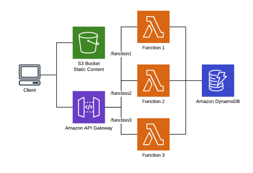

# Serverless Chaos Engineering Demo

Demo application for [failure-lambda](https://github.com/gunnargrosch/failure-lambda) v1.0.0 — chaos engineering for AWS Lambda.

Three Lambda functions behind an HTTP API, each using a different failure-lambda integration path:

| Function | Runtime | Integration | How it works |
|----------|---------|-------------|--------------|
| Wrapper | Node.js 22.x | `failureLambda()` | Import the library and wrap your handler |
| Middy | Node.js 22.x | `failureLambdaMiddleware()` | Add as Middy middleware plugin |
| Layer | Python 3.13 | Lambda Layer | Zero code changes — layer intercepts the Runtime API |

All three functions fetch a random item from DynamoDB and return it. A static frontend polls the endpoints every 5 seconds, showing response times and status codes side by side — making it easy to see the impact of injected failures.



## Prerequisites

- [AWS SAM CLI](https://docs.aws.amazon.com/serverless-application-model/latest/developerguide/install-sam-cli.html)
- Node.js 22.x
- [jq](https://jqlang.org/) (used by the seed script)
- AWS credentials configured
- failure-lambda layer published in your account (download from [releases](https://github.com/gunnargrosch/failure-lambda/releases/latest))

### Publish the layer

```bash
aws lambda publish-layer-version \
  --layer-name failure-lambda \
  --zip-file fileb://failure-lambda-layer-x86_64.zip \
  --compatible-architectures x86_64 \
  --region YOUR_REGION
```

Note the `LayerVersionArn` from the output — you'll need it during deployment.

## Deploy

1. Build and deploy:

```bash
sam build
sam deploy --guided
```

When prompted, provide the `FailureLambdaLayerArn` parameter with the ARN from the layer publish step.

2. Note the stack outputs (`ApiUrl`, `TableName`, and the three SSM parameter names).

3. Seed DynamoDB:

```bash
npm run seed -- TABLE_NAME
```

Replace `TABLE_NAME` with the `TableName` stack output.

4. Configure the frontend:

```bash
cp client/dist/assets/js/env.js.template client/dist/assets/js/env.js
```

Edit `env.js` and set `apiBase` to your `ApiUrl` output.

5. Open `client/dist/index.html` in a browser (or host `client/dist/` via S3, CloudFront, or a local server).

## Inject failures

Each function has its own SSM parameter. Use the failure-lambda CLI or update SSM directly.

### Using the CLI

```bash
# Check current config
npx failure-lambda status --param PARAMETER_NAME

# Enable latency injection
npx failure-lambda enable latency --param PARAMETER_NAME

# Disable all injection
npx failure-lambda disable --all --param PARAMETER_NAME
```

### Using SSM directly

```bash
aws ssm put-parameter --name PARAMETER_NAME --type String --overwrite \
  --value '{"latency":{"enabled":true,"percentage":100,"min_latency":200,"max_latency":500}}'
```

Replace `PARAMETER_NAME` with the SSM parameter for the function you want to target (`WrapperConfigParam`, `MiddyConfigParam`, or `LayerConfigParam` from the stack outputs).

### Failure modes

| Mode | Effect |
|------|--------|
| `latency` | Adds random delay before the handler runs |
| `statuscode` | Returns an HTTP status code, skipping the handler |
| `exception` | Throws an exception, skipping the handler |
| `denylist` | Blocks outgoing requests to matching hostnames |
| `diskspace` | Fills /tmp to simulate disk pressure |
| `timeout` | Sleeps until the function times out |
| `corruption` | Replaces the response body after the handler runs |

See the [failure-lambda README](https://github.com/gunnargrosch/failure-lambda#failure-modes) for full configuration details.

## Clean up

```bash
sam delete
```

Then delete the layer version if no longer needed:

```bash
aws lambda delete-layer-version --layer-name failure-lambda --version-number VERSION
```

## Project structure

The root `package.json` is a task runner for build, deploy, seed, and test scripts. Lambda runtime dependencies live in each function's own `package.json` under `src/` and are bundled by SAM's esbuild integration. The root `devDependencies` exist only so the Node.js test runner can resolve imports when running tests locally.

The `client/dist/` directory contains pre-built static frontend assets with no build step — edit the HTML/CSS/JS files directly.

## Videos

- https://www.youtube.com/watch?v=vKurdrGMFpg
- https://www.youtube.com/watch?v=Cw-JmAJHG-g
- https://www.youtube.com/watch?v=xxogwzUMg7c

## License

MIT — see [LICENSE](LICENSE).

## Author

**Gunnar Grosch** — [GitHub](https://github.com/gunnargrosch) | [LinkedIn](https://www.linkedin.com/in/gunnargrosch/)
